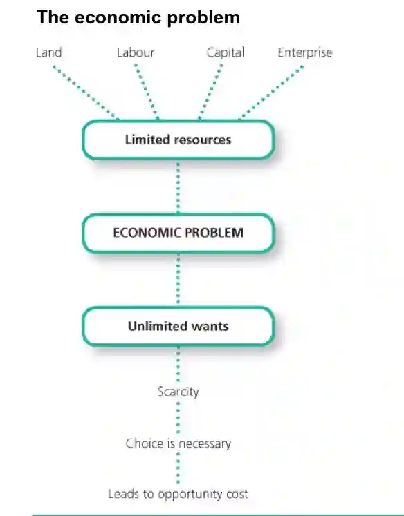

**Need**: a good or service essential for living. Examples include water and food and shelter.

**Want**: a good or service that people would like to have, but is not required for living. Examples include cars and watching movies.

**Scarcity** is the basic economic problem. It is a situation that exists when **there are unlimited wants and limited resources** to produce the goods and services to satisfy those wants. For example, we have a limited amount of money but there are a lot of things we would like to buy, using the money.

