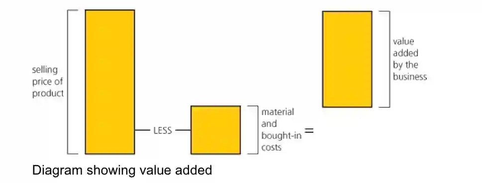

**Added value is the difference between the cost of bought in materials and the selling price of the product.**

Which is, the amount of value the business has added to the raw materials by turning it into finished products. Every business wants to add value to their products so they may charge a higher price for their products and gain more profits.

How to increase added value?

* **Reducing the cost of production**. Added value of a product is its price less the cost of production. Reducing cost of production will increase the added value.

* **Raising prices**. By increasing prices they can raise added value, in the same way as described above.

But there will be problems that rise from both these measures. To lower cost of production, cheap labour, raw materials etc. may have to be employed, which will create poor quality products and only lowers the value of the product. People may not buy it. And when prices are raised, the high price may result in customer loss, as they will turn to cheaper products.

We can also increase added value of a good/service by:

* Branding

* Adding special features

* Provide premium services etc.

