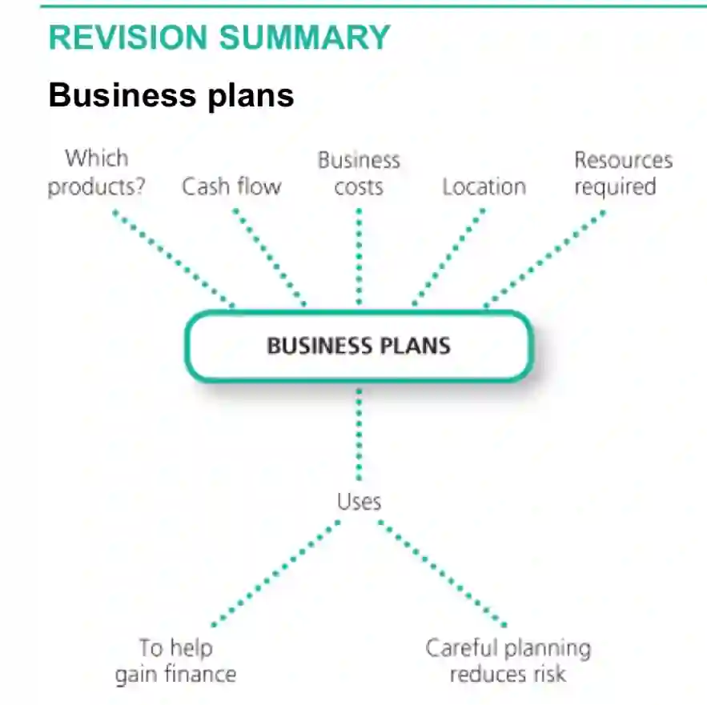

**A business plan is a document containing the business objectives and important details about the operations, finance and owners of the new business.**

It provides a complete description of a business and its plans for the first few years; explains what the business does, who will buy the product or service and why; provides financial forecasts demonstrating overall viability; indicates the finance available and explains the financial requirements to start and operate the business.

Some of the content of a regular business plan are:

1. Description of the Business

2. Products and services - what the business sells or delivers

3. The market - the target market of the business

   * Total market size

   * Predicted market growtg

   * Target market

   * Analysis of competitors

   * Predicted changes in the market in the future

   * Forecast sales revenue from the product(s)

4. Business location and how products will reach customers

5. Organisation structure and management

6. Financial information

7. Business strategy

   **Advantages of a Business Plan:**

   * Lesser chance of losing sight of the mission

   * Helps motivate the employees

   * Provides a clear direction

   * Easier to get a loan or bank overdraft

   