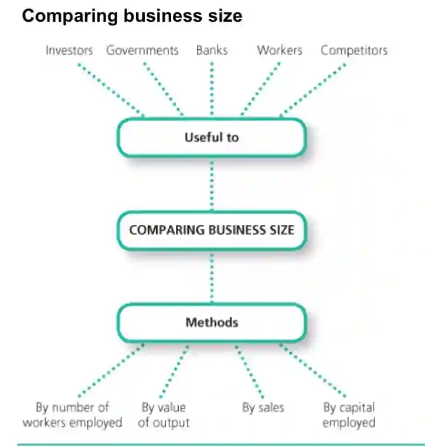

Businesses come in many sizes. They can be owned by a single individual or have up to 50 shareholders. But how can we classify a business as big or small?

Business size can be measured in the following ways:

* **Number of employees:** larger firms have larger workforce employed

* **Value of output:** larger firms are likely to produce more than smaller ones

* **Value of capital employed:** larger businesses are likely to employ much more capital than smaller ones

However, these methods have their limitations and are not always accurate.

* **Number of employees:** not accurate for capital intensive firms

* **Value of output:** unreliable because some different types of products are valued differently, and the size of the firm doesn’t depend on this

* **Value of capital employed:** not a reliable measure when comparing a capital-intensive firm with a labour-intensive firm.

**Who would find it useful to compare the size of the business?**

* **Investors:** before deciding which business to invest in

* **Governments:** there are different tax rates for small and large firms

* **Competitors**: to compare their size and importance of firms

* **Workers**: to see how many people they are working with

* **Banks:** when granting loans

