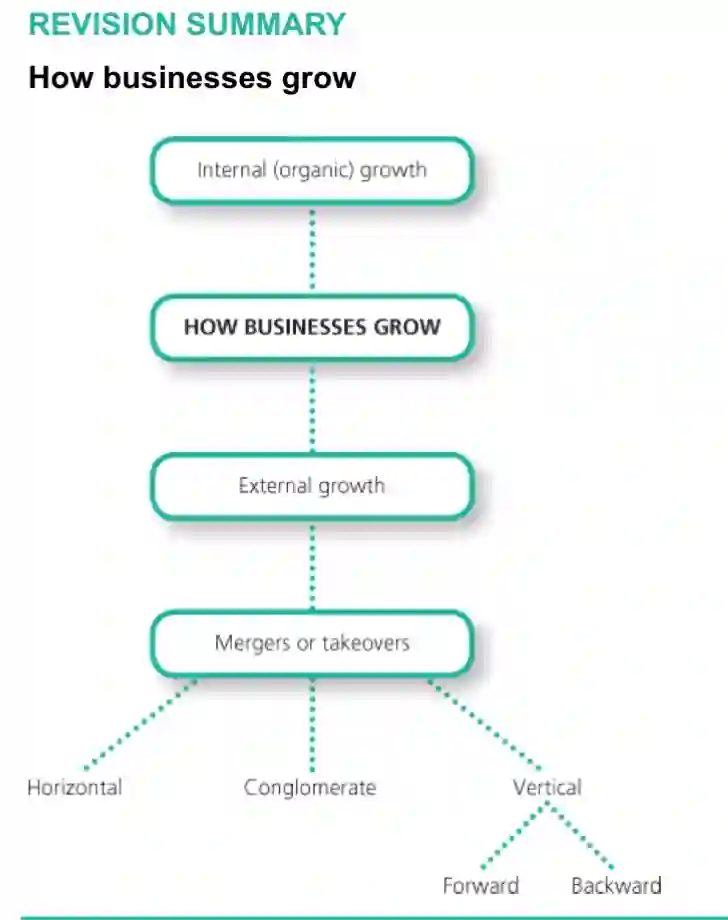

Businesses want to grow because growth helps reduce their average costs in the long-run, help develop increased market share, and helps them produce and sell to them to new markets.

There are two ways in which a business can grow- internally and externally.

1. **Internal growth**

This occurs when a business **expands its existing operations**. For example, when a fast food chain opens a new branch in another country. This is a slow means of growth but easier to manage than external growth.

2. **External growth**

This is when a business **takes over or merges with another business**. It is sometimes called **integration** as one firm is ‘integrated’ into the other.

A **merger** is when the owner of two businesses agree to join their firms together to make one business.

A **takeover** occurs when one business buys out the owners of another business , which then becomes a part of the ‘predator’ business.

External growth can largely be classified into three types:

### **Horizontal merger/integration**: This is when one firm merges with or takes over another one in **the same industry at the same stage of production**. For example, when a firm that manufactures furniture merges with another firm that also manufacturers furniture.

**Benefits:**

* Reduces number of competitors in the market, since two firms become one.

* Opportunities of economies of scale

* Merging will allow the businesses to have a bigger share of the total market.

  ### **Vertical merger/integration**: This is when one firm merges with or takes over another firm in **the same industry but at a different stage of production**. Therefore, vertical integration can be of two types:

  * #### **Backward vertical integration:**  When one firm merges with or takes over another firm in the same industry but at **a stage of production that is behind the ‘predator’ firm**. For example, when a firm that manufactures furniture merges with a firm that supplies wood for manufacturing furniture.

    **Benefits:**

    Merger gives assured supply of essential components.

    * The profit margin of the supplying firm is now absorbed by the expanded firm.

    * The supplying firm can be prevented from supplying to competitors

      * **Forward vertical integration:** When one firm merges with or takes over another firm in the same industry but **at a stage of production that is ahead of  the ‘predator’ firm**. For example, when a firm that manufactures furniture merges with a furniture retail store.

        Benefits:

        * Merger gives assured outlet for their product.

        * The profit margin of the retailer is now absorbed by the expanded firm.

        * The retailer can be prevented from selling the goods of competitors.

* **Conglomerate merger/integration:** This is when one firm merges with or **takes over a firm in a completely different industry**. This is also known as ‘diversification’. For example, when a firm that manufactures furniture merges with a firm that produces clothing.

  **Benefits**:

  * Conglomerate integration allows businesses to have activities in more than one country. This allows the firms to spread its risks.

  * There could be a transfer of ideas between the two businesses even though they are in different industries. This transfer o ideas could help improve the quality and demand for the two products.

**Drawbacks of growth**

* **Difficult to control staff:** as a business grows, the business organisation in terms of departments and divisions will grow, along with the number of employees, making it harder to control, co-ordinate and communicate with everyone

* **Lack of funds**: growth requires a lot of capital.

* **Lack of expertise:** growth is a long and difficult process that will require people with expertise in the field to manage and coordinate activities

* **Diseconomies of scale:** this is the term used to describe how average costs of a firm tends to increase as it grows beyond a point, reducing profitability.

