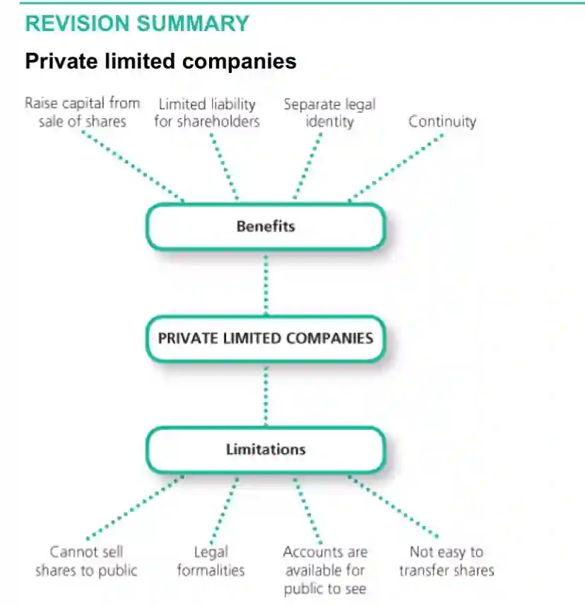
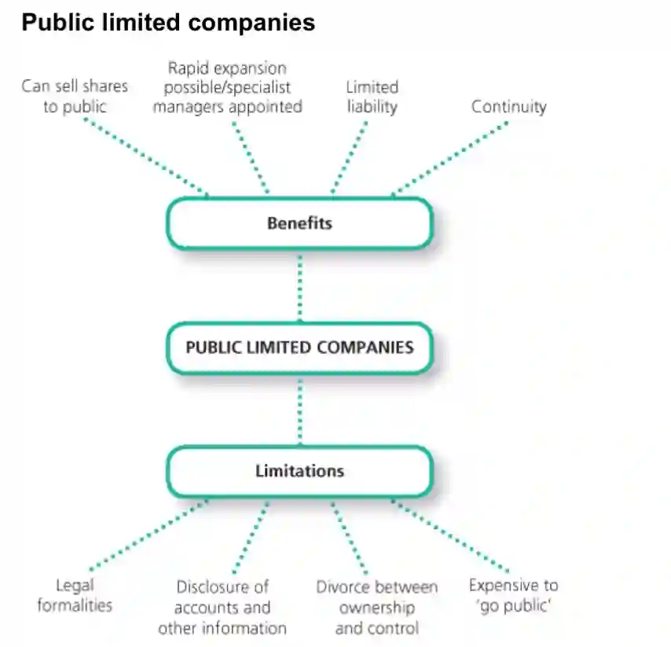

These companies **can sell shares**, unlike partnerships and sole traders, to raise capital. Other people can buy these shares (stocks) and become a **shareholder**(owner) of the company.

Therefore they are  jointly owned by the people who have bough it’s stocks. These shareholders then receive **dividends** (part of the profit; a return on investment).

The shareholders in companies have **limited liabilities**. That is, only their individual investments are at risk if the business fails or leaves debts. If the company owes money, it can be sued and taken to court, but it’s shareholders cannot.

 The companies have **a separate legal identity** from their owners, which is why the owners have a limited liability. 

Companies also enjoys **continuity**, unlike partnerships and sole traders. That is, the business will continue even if one of it’s owners retire or die.

Shareholders will elect a **board of directors** to manage and run the company in it’s day-to-day activities. In small companies, the shareholders with the highest percentage of shares invested are directors, but directors don’t have to be shareholders. The more shares a shareholder has, the more their voting power.

These are two types of companies:
**Private Limited Companies**: One or more owners who can sell its’ shares to only the people known by the existing shareholders.

**Public Limited Companies**: Two or more owners who can sell its’ shares to any individual/organization in the general public through stock exchanges.

Advantages:

* Limited Liability: this is because, the company and the shareholders have separate legal identities.

* Raise huge amounts of capital: selling shares to other people (especially in Public Ltd. Co.s), raises a huge amount of capital, which is why companies are large.

* Public Limited Companies can advertise their shares, in the form of a prospectus, which tells interested individuals about the business, it’s activities, profits, board of directors, shares on sale, share prices etc. This will attract investors.

Disadvantages:

* **Required to disclose financial information**: Sometimes, private limited companies are required by law to publish their financial statements annually, while for public limited companies, it is legally compulsory to publish all accounts and reports. All the writing, printing and publishing of such details can prove to be very expensive, and other competing companies could use it to learn the company secrets.

* **Private Limited Companies cannot sell shares to the public**. Their shares can only be sold to people they know with the agreement of other shareholders. Transfer of shares is restricted here. This will raise lesser capital than Public Ltd. Companies.

* Public Limited Companies **require a lot of legal documents** and investigations before it can be listed on the stock exchange.

* Public and Private Limited Companies must also hold an **Annual General Meeting (AGM)**, where all shareholders are informed about the performance of the company and company decisions, vote on strategic decisions and elect board of directors. This is very expensive to set up, especially if there are thousands of shareholders.

* **Public Limited Companies may have managerial problems**: since they are very large, they become very difficult to manage. Communication problems may occur which will slow down decision-making.

* **In Public Limited Companies, there may be a divorce of ownership and control**: The shareholders can lose control of the company when other large shareholders outvote them or when board of directors control company decisions.

