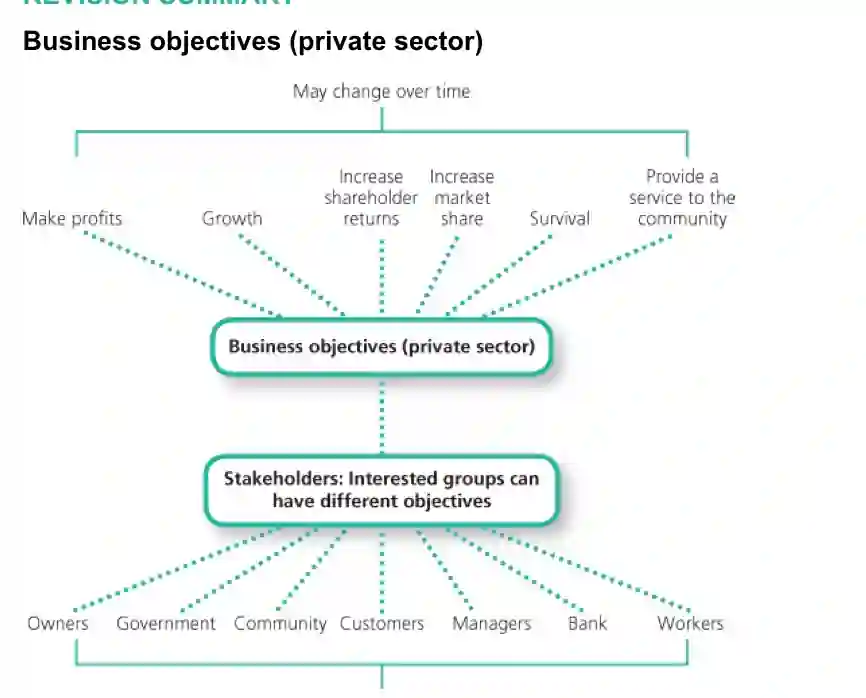

Objectives vary with different businesses due to size, sector and many other factors. However, many business in the private sector aim to achieve the following objectives.

* **Survival:**  new or small firms usually have survival as a primary objective. Firms in a highly competitive market will also be more concerned with survival rather than any other objective. To achieve this, firms could decide to lower prices, which would mean forsaking other objectives such as profit maximization.

* **Profit:** this is the income of a business from its activities after deducting total costs.  Private sector firms usually have profit making as a primary objective. This is because profits are required for **further investment** into the business as well as for the **payment of return** to the shareholders/owners of the business.

* **Growth:** once a business has passed its survival stage it will aim for growth and expansion. This is usually measured by value of sales or output. Aiming for business growth can be very beneficial. A larger business can ensure **greater jobsecurity** and **salaries** for employees. The business can also benefit from higher **market share** and **economies of scale**.

* **Market share:** this can be defined as the proportion of total market sales achieved by one business. Increased market share can bring about many benefits to the business such as increased customer loyalty, setting up of brand image, etc.

* **Service to the society:** some operations in the private sectors such as social enterprises do not aim for profits and prefer to set more economical objectives. They aim to better the society by providing **social, environmental** and **financial** aid. They help those in need, the underprivileged, the unemployed, the economy and the government.

A business’ objectives do not remain the same forever. As market situations change and as the business itself develops, its objectives will change to reflect its current market and economic position.For example, a firm facing serious economic recession could change its objective from profit maximization to short term survival.

