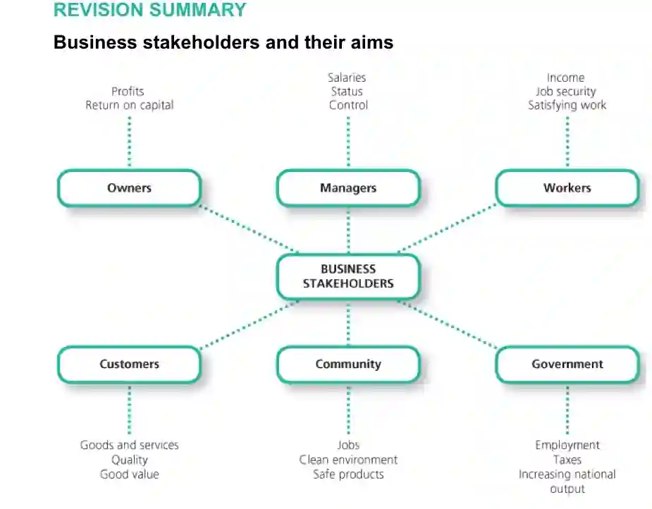

A **stakeholder is any person or group that is interested in or directly affected by the performance or activities of a business**. These stakeholder groups can be external – groups that are outside the business or they can be internal – those groups that work for or own the business.

Internal stakeholders:

* **Shareholder/ Owners: t**hese are the risk takers of the business. **They invest capital into the business** to set up and expand it. These shareholders are liable to a share of the profits made by the business.

  
  **Objectives:**

  * Shareholders are **entitled to a rate of return on the capital they have invested** into the business and will therefore have profit maximization as an objective.

  * **Business growth** will also be an important objective as this will ensure that the value of the shares will increase.

* **Workers:** these are the **people that are employed by the business** and are directly involved in its activities.

  
  **Objectives:**

  * **Contract of employment** that states all the right and responsibilities to and of the employees.

  * **Regular payment** for the work done by the employees.

  * Workers will want to benefit from **job satisfaction** as well as motivation.

  * The employees will want **job security**– the ability to be able to work without the fear of being dismissed or made redundant.

* **Managers:** they are **also employees but managers control the work of others.** Managers are in charge of making key business decisions.

  
  **Objectives:**

  * Like regular employees, managers too will aim towards a **secure job**.

  * **Higher salaries** due to their jobs requiring more skill and effort.

  * Managers will also wish for **business growth** as a bigger business means that managers can control a bigger and well known business.

External Stakeholders:

* **Customers**: they are a very important part of every business. They **purchase and consume the goods and services** that the business produces/ provides. Successful businesses use **market research** to find out customer preferences before producing their goods.

  
  **Objectives:**

  * **Price that reflects the quality** of the good.

  * The products must be **reliable and safe**. i.e., there must not be any false advertisement of the products.

  * The products must be **well designed** and of a perceived quality.

* **Government:** the role of the government is to **protect the workers and customers from the business’ activities** and safeguard their interests.

  
  **Objectives:**

  * The government will want the business to grow and survive as they will bring a lot of benefits to the economy. A successful business will help **increase the total output** of the country, will **improve employment** as well as **increase government** **revenue** through payment of taxes.

  * They will expect the firms to stay within the rules and regulations set by the government.

* **Banks:** these banks **provide financial help** for the business’ operations

  
  **Objectives:**

  * The banks will expect the business to be able to repay the amount that has been lent along with the interest on it. The bank will thus have business liquidity as its objective.

* **Community:** this consists of all the stakeholder groups, especially the third parties that are affected by the business’ activities.

  
  **Objectives:**

  * The business must **offer jobs and employ local employees**.

  * The production process of the business must in **no way harm the environment**.

  * Products must be **socially responsible** and must not pose any harmful effects from consumption.

