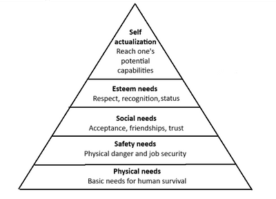

# People in Business

## Motivating Employees

### **Motivation**

* **Motivation**: factors that influence the workers' behaviour towards achieving business goals.
* **Factors that influence motivation at work:**
  * Money
  * Job Security
  * Training
  * Promotion
  * Status
  * Responsibilities
  * Work environment

### **Benefits of a Well-Motivated Workforce**

* Improved productivity
* Low rate of absenteeism (Workers’ non-attendance at work without a good reason)
* Low rate of labour turnover (The rate at which workers leave the business)
* Better quality goods and services
* Improved labour productivity (A measure of the efficiency of workers by calculating the output per worker)

### **Key Motivational Theories**

**F.W. Taylor - Scientific Management Theory**

* It aims to reduce inefficiency in the workplace by finding the quickest method of performing tasks and training all workers to use this method.
* The theory of economic man: the theory that humans are only motivated by money, in which Taylor believed that money was the only motivational factor.
* The piece rate method of paying production came from his research.
* **Disadvantages:**
  * His ideas were too simplistic
  * If employees are unfulfilled with their work, productivity won’t be gained, no matter how high the wage.
  * If employees’ output can’t be measured, practical problems arise.

**Abraham Maslow: Concept of Human Needs - Maslow’s Hierarchy**

 

| Advantages | Disadvantages |
|----|----|
| It is possible for managers to satisfy some or all of their needs | It is difficult to identify how much of the needs have been met or which level each worker is on |
| Easy to set goals and objectives | It doesn’t include money as a need |
|    | Not all needs are included. |
|    | Self-actualization is rarely, if ever, achieved. |

**Fredrick Herzberg - Two-Factor Theory**

* **Hygiene Factors**: The factors that must be present in the workplace to prevent job dissatisfaction.
  * **Working Conditions**: Things that show how clean and safe the workplace is and what facilities are provided
  * **Relationship with others**: Good working relationships with workers and managers, and treated fairly with respect.
  * **Salary and wages**
  * **Supervisions**: Leadership style and how closely works are supervised
  * **Company policy and administration**: rules and procedures that control and affect the workplace.
* Hygiene Factors must be present to prevent job dissatisfaction
* **Job dissatisfaction**: How unhappy and discontent a person is with their job.
* **Motivators (Factors that influence a person to increase their effort):**
  * **The work itself**: Variety of jobs and challenging tasks through job enrichment.
  * **Responsibility**: Giving workers responsibility for tasks they perform.
  * **Advancement**: Opportunity for promotion
  * **Achievement**: They feel like they have reached a challenging goal.
  * **Recognition of Achievements**: Recognised by the people for their achievements

