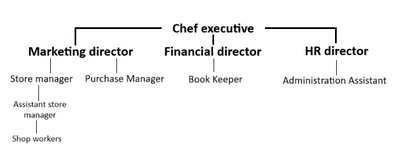
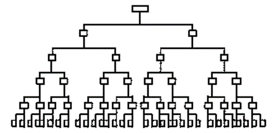
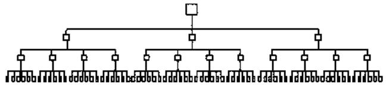

## Organisation and Management

* **Organisational Structure**: levels of management and division of responsibilities within a company.

* **Organisational Charts**: refers to diagrams that outline the internal management structure.

* **Hierarchy** refers to the levels of management in any organisation.

* **Levels of Hierarchy**: refers to management/supervisors/other employees who are given a similar level of responsibility in an organisation.

* **Example of Organisational Chart:**

  

* **Benefits:**

  * The chart shows how everybody is linked in the organisation, which allows employees to be aware of their communication channel (chain of command).
  * Everyone can see what they are accountable for, which they have authority over, and who to take orders from.
  * Everyone is in a department, thus giving a sense of belonging

* **Chain of Command**: The structure in an organisation allows instructions to be passed down from senior management to subordinates.

* **The Span of Control**: The number of subordinates working directly under a manager.

* **Subordinate**: an employee below another employee in the organisation’s hierarchy.

**Two Types of Organisational structures of a business:**

* **Tall Structure**: the longer the chain of command is, the ‘taller‘ the organisational structure and the ‘narrower‘ the span of control.

* **Flat Structure**: when a chain of command is short, the organisation will have a ‘wider’ span of control, thus making it a ‘flat‘ structure.

  

* **Advantages of Short Chain of Command**:

  * Communication and decision-making are quicker.
  * Fewer management levels to build connections with by the top management.
  * The span of control will be wider, encouraging managers to delegate more and allowing workers to feel trusted.

* **Advantages of a long chain of command**:

  * As decisions get passed down, it is checked by multiple people, thus reducing error and preventing bad decisions from happening
  * Lesser subordinates means management can focus more on their designated workers.

* **Factors affecting the size of the span of control**:

  * Difficulty of the task
  * The experience and skill of workers
  * The size of the business
  * the level of hierarchy
  * Management style

* **Delayering**: reducing the size of the hierarchy by removing one or more levels, often the middle management.

|Advantages|Disadvantages|
|:---|:---|
|Reduces cost|Increased workload on managers, thus decreasing the quality of work and its completion.|
|Communication and decision-making are quicker due to reduced chain of command.|Have to make redundancy payments to employees who lost their job|
|Increases the opportunity for delegation, which helps in motivation|Reduction in job security|
|Senior managers are in close touch with what is going on in the business|Reduce effective management of subordinates|

* **Delegation**: Giving a subordinate the authority to perform particular tasks.

|Advantages|Disadvantages|
|:---|:---|
|Application of job enrichment, leading to job satisfaction|Some managers are reluctant to delegate, as they will be held accountable for any errors|
|A form of training for junior managers|Managers lose some control over subordinates|
|Achieving the Esteem needs (Maslow’s hierarchy)||

* **Centralised Organisation**: one where all the important decision-making power is held at the head office/the centre and then passed down to lower levels.

|Advantages|Disadvantages|
|:---|:---|
|Decision-making is often quicker|Slower communication|
|Decisions are taken for the benefit of the whole business|Unable to respond quickly to changes in the local market|
|Greater use of specialist staff improves decision-making|May reduce motivation|

* **Decentralised Organisation:**

|Advantages|Disadvantages|
|:---|:---|
|Decisions are made based on local needs.|Decisions taken might not be in the interest of the business|
|It can be used to train junior managers.|Poor decisions might be made often due to lack of experience and skills|
|Delegation helps improve worker motivation.||
