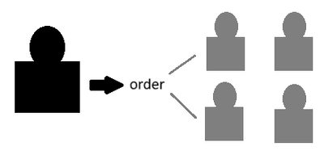
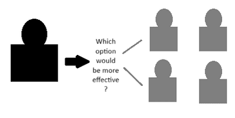
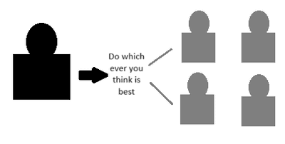

## Leadership Styles

* **Leadership Styles**: are the different approaches to dealing with people and making decisions when in a position of authority.
* There are three leadership styles:
* **Autocratic Leadership:** where the manager expects to be in charge of the business and to have their orders followed. Characteristics:

   
  * A leader does all the decision-making
  * Don’t take input from others.
  * Highly structured working environment

| Advantages | Disadvantages |
|----|----|
| Quick decision-making process | There is no opportunity for employee input into key decisions, which can be demotivating |

* **Democratic Leadership**: gets other employees involved in the decision-making. Characteristic:

   
  * Motivation is higher
  * Creativity and engagement with workers are encouraged.
  * Workers and employees are involved in decision-making.

| Advantages | Disadvantages |
|----|----|
| Better Decisions could result from consulting with employees using their ideas and experiences. | Unpopular decisions could not effectively be made using this style |

* **Laissez-Faire Leadership**: makes the broad objectives known to employees, but then they are left to make decisions and organise their work. Characteristics:

   
  * Workers and employees are expected to make the decisions.
  * The leader will only give guidance.
  * The leader only takes charge when necessary.

| Advantages | Disadvantages |
|----|----|
| Encourage employees to show creativity and responsibility | It is unlikely to be appropriate in organisations with a consistent and clear decision-making structure. |

