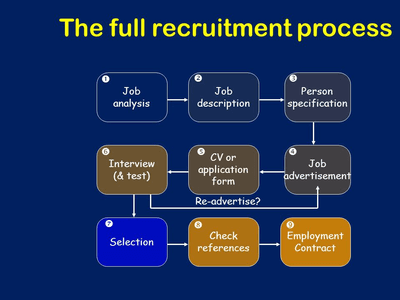

## Recruitment Process

1. **Analyse the exact nature of the job and duties to be undertaken.**

   * **Job analysis**: it identifies and records the responsibilities and tasks relating to a job

2. **Job description**: a document that outlines the tasks and responsibilities that will need to be carried out as part of the specific job – so that applicants know what the job involves and so they know if they are suitable to apply for the job

   **Usual Requirements:**

   * The level of educational qualification
   * Special skills, knowledge, or a particular attitude
   * Personal Characteristics

3. **Design a job specification**:

   * **Job specification** is a document that outlines the requirements, qualifications, expertise, and attributes needed for a specified job. Several functions of a job specification:
     * This information should be given to applicants so they know exactly what the job entails.
     * Allows a job specification to be drawn up to see if they are skilled.
     * It shows if an employee is working effectively once they are employed.
   * The contents of a Job specification:
     * Condition of employment salary, hours, permission, etc.
     * Training that will be offered
     * Opportunities for promotion
     * Purpose of the job
     * Main duties/addition or occasional duties

4. **Person Specification**: outlines the required skills, qualifications, personal qualities, etc., for a specific job – to ensure a suitably qualified person is appointed and that they have the skills, etc., to do the job required.

5. **Advertise the vacancy**:

   * The first stage is to decide how the post will be filled.      

**Internal Recruitment**: is when a vacancy is filled by someone who is an existing employee of the business

|Advantages|Disadvantages|
|:---|:---|
|Quicker and cheaper than external recruitment.|No new ideas or experiences come into the business.|
|The reliability, ability, and potential of the person are known.|Rivalry and jealousy may arise.|
|The person is already familiar with the organisation's structure and expectations.|The quality of internal candidates might be low.|
|It can be motivating for other employees to see their fellow workers promoted.||

**External Recruitment**: when any suitable applicant outside the business fills a vacancy

|Advantages|Disadvantages|
|:---|:---|
|A more comprehensive selection of candidates.|Increased costs due to advertising.|
|Adding fresh perspective and ideas.|Additional training|
|Enhancing diversity in the organisation.|Adds a transitional period for all employees to adjust to the new business|
|Finding a specialised candidate who fits the requirements perfectly.|Effects on employee morale.|
|Can help the competitiveness of the business||
|Reduce tension between employees.||

5. **Send out application forms to the applicants or read curriculum resumes and letters of application**.
   * Advertising job vacancies can be done in several ways:
     * Local newspapers
     * National newspapers
     * Specialist magazines
     * Online recruitment sites
     * Recruitment agencies
     * Centres run by the government
6. **Produce a shortlist from the applications for interviews and take up references**.
   * Applicants must provide a referee (someone the potential employer can contact, intending to get more information/references from).
   * Interviews are the most used form of selection. Its primary purpose is to assess in the shortest time possible:
     * Applicant’s ability to do the job
     * Any personal qualities that could be beneficial or not.
     * The general character and personality of the applicant.
   * Some businesses include tasks in the selection process, such as:
     * Skill test (ability to carry out specific tasks)
     * Aptitude test (candidate’s potential of learning a new skill).
     * Personality test (used if a particular type of person is required).
     * Group situation test (to show how well they work with a team).
7. **Hold interviews and select tasks**.
8. **Select suitable applicants and offer them the job. Reply to unsuccessful applicants**.
   * The final decision can depend on several factors:
     * Work experience
     * Education and other qualifications
     * Age
     * Internal
     * External
     * Circumstance