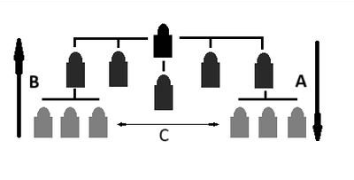

## Methods of Communication

* **Formal Communication**: when messages are sent through established channels using professional language.
* **Informal Communication**: when information is sent and received casually using everyday language.

### **The Direction of Communication**

 

* **Arrow A** shows **downward communication**: messages from managers to subordinates. Used for instructions or statements, no feedback.
* **Arrow B** shows **upward communication**: messages or feedback can be passed from subordinates to managers.
* **Arrow C** shows **horizontal communication**: when people at the same level in an organisation communicate. Ideas and info can be shared. Conflict can happen.

