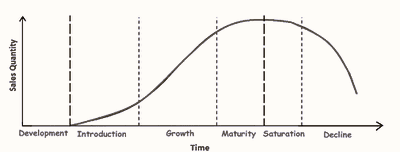

## Product

* Some products are sold to consumers, and some to other businesses.
* They are usually grouped:
  * **Consumer goods**: bought by consumers for their own use. Can be perishable goods such as food or long-lasting such as furniture.
  * **Consumer services**: services bought by consumers for their own use. Ex. Cleaners
  * **Producer goods**: there are goods that are produced for other businesses’ use to help with the production process. Ex. Trucks
  * **Producer services**: services that are produced to help other business. Ex. Accountants.
  * Identifying the type of product is important as it decides how the product would be advertised/marketed and developed.
* Points to consider about choosing product:
  * Satisfying existing needs and wants of consumers
  * Not be expensive to produce.
  * New and original idea
  * Unique selling point
  * Capable of stimulating new wants from their consumers.

**Development of New Products:**

1. Generate ideas
2. Select the best idea for further development
3. Decide if the company will be able to sell enough for the product to be a success.
4. Develop a prototype
5. Launch the product in one area to test the market
6. Go to a full launch of the product to the whole market.

| Benefits | Drawbacks |
|----|----|
| USP – a unique selling point: a special feature about a product that differentiates it from its competitors’ product. | Costs of carrying out market research and analysing the findings |
| Diversification | Cost of producing trial products, including waste materials |
| Allows businesses to expand into new and existing markets | Brand image is damaged if the product fails to meet consumer demand |
|    | The lack of sales if the target market is wrong |

### **Importance of Brand Image**

* **Brand name**: the unique name of a product that distinguishes it from other brands.
* **Brand loyalty**: when consumers keep buying the same brand again instead of choosing a competitor’s brand.
* **Brand image**: an image or identity given to a product which gives it a personality of its own and distinguishes it from its competitors.
* Good branding includes:
  * Brand name
  * Higher quality than unbranded products.
  * Unique packaging
  * Brand loyalty
  * Assured quality
  * Creates a brand image associated with consuming the product.

### **Role of Packaging**

* **Packaging**: the physical container or wrapping for a product.  2 functions - protect and promote product
  * Protects the product and makes it easier to transport
  * Eye catching
  * Carries information about the product
  * Promotes brand image

### **Product Life Cycle (PLC)**

* **Product life cycle:** describes the stages a product will pass through from its introduction, through its growth until it is mature, and then finally its decline.

1. **Development**: First, the product is developed. The prototype will be tested in the market before its launch. There are no sales during this time.
2. **Introduction:** Then it is introduced or launched in the market. Sales are often slow. No profit made as development costs are not yet covered.
3. **Growth**: The product gains more sales. Advertising is changed to persuade and encourage customer loyalty. Prices reduced due to competitors and profit starts to be made.
4. **Maturity**: sales increase slowly. Competition intense and advertising is used to maintain sales growth and profit is at its highest.
5. **Saturation**: sales have stabilised at their highest point. Competition and advertising is high and stable, but profit starts to fall as sales static and prices are reduced to be competitive.
6. **Decline**: sale of product starts to decline  as new products enter, or it has lost its appeal. Product is withdrawn from market and sales, prices and advertising low until it stopped.

    

### **How Stages of PLC Influence Marketing Decisions**

* Introduction –
  * Product – newly launched product
  * Price – price skimming or penetration pricing
  * Place – limited range of exclusive shops (if price skimming is used)
  * Promotion – informative advertising
* Growth
  * Product – remains the same
  * Price – raise prices if penetration pricing was used
  * Place – increase the number of outlets, e-commerce
  * Promotion – establish a strong brand identity through promotional activities.
* Maturity/Saturation
  * Product – plans for product changes begin
  * Price – prices are lowered to stay competitive
  * Place – full range of distribution channels used
  * Promotion – sales promotion techniques to encourage repeat purchases
* Decline
  * Product – changes made to extend the life cycle
  * Price – lower prices
  * Place – sell through low-cost outlets
  * Promotion – re-launch the product as an extension strategy

### **Extending Product Life Cycle:**

* **Extension strategy**: a way of keeping a product at the maturity stage of the life cycle and extending the cycle.
* Introduce new variations into the original product
* Sell into new markets
* Make small changes to the product’s design, cover, colour
* Sell through additional retail outlets
* Introduce a new, improved version of the old product
* Use a new advertising campaign

