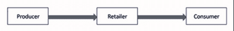
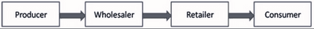

## Place (Distribution Channels)

* Products should be available when and where customers need them
* Wrong place, low sales and profits
* The place must be convenient for consumers
* **Distribution Channel**: is how a product is passed from the place of production to the customer.

**There are four main distribution channels:**

* **Manufacturer sells products** **directly to consumers** (i.e. car components to car factories).
  * This channel is most common with business-to-business transactions.

     

| **Benefits** | **Limitations** |
|----|----|
| Very simple | It is impractical because consumers don’t usually live near factories |
| Suitable for products that are sold straight out of factories | Not suitable for products that can’t be sent quickly by post, especially if they’re perishable or easily breakable goods. |
| There is a lower price for consumers (cuts retailer) | It is not cost-effective, as sending products by post is expensive |
| Products can be sold by mail order catalogue or via the internet. |    |

* Producers sell to retailers, who sell to consumers (i.e., farms selling food to big supermarkets).
  * This channel is most common where retailers and large such as supermarkets or the product is expensive, Ex. furniture or jewellery.

 

| **Benefits** | **Limitations** |
|----|----|
| Manufacturer sells lots of stock to retailer | There is no direct contact with customers, which makes It hard to create customer loyalty. |
| Cheaper transportation costs because all products go to one place | Price is often higher than ‘direct selling‘ as the retailer has to cover its costs and make a profit |
| Lower storage costs for the manufacturer |    |

* **Producers sell to wholesalers**, who buy in bulk, divide their stock into smaller quantities, and sell them to retailers.

   

| **Benefits** | **Limitations** |
|----|----|
| Reduces storage costs for small retailers because small quantities are sold | More expensive to buy from a wholesaler than from a manufacturer |
| Small quantities, so transport costs are low | A wholesaler might not have all the products a retailer wants |
| Wholesalers can give feedback on what sells well to producer | It takes longer to get to the consumer |
|    | Huge gap between the manufacturer and the customer |
|    | Consumer prices may be higher than direct selling, as retailers and wholesalers need profit. |

* A manufacturer hires an agent (person or business) that will sell products on behalf of the manufacturer.
  * Agent: an independent person or business appointed to deal with sales and distribution of a product or range of products.

     

| **Benefits** | **Limitations** |
|----|----|
| Agents know the most profitable places & prices to sell in other markets that manufacturers may not know. | Manufacturers lose much control over how the product is sold to customers. |
| Agents will provide advice on the best ways to survive new markets. | Higher costs for consumers, as agents will need compensation for expenses. |
| Gives the manufacturer some control over the way product is sold. |    |

### **Methods of Distribution**

* **E-Commerce**
  * Selling of goods and services through the internet

| **Benefits to the business** | **Problems to business** |
|----|----|
| Cheaper | Website must be maintained |
| Customers are encouraged to buy in bulk | High distribution costs |
| Business-2-Business e-commerce is cheaper | No direct contact |
| Wider options for customers, brand image and loyalty | Returns – higher costs |
|    | A stock system will be needed. |

| **Benefits to consumers** | Problems for consumers |
|----|----|
| No need to go out | Internet needed |
| Wide options | High chances of fraud and theft |
| Easy Comparison | Products can’t be physically examined |
| Payment through net banking | No direct contact |
| Easy access to imported goods |    |
| Low prices |    |

* Other methods include:
  * Department stores
  * Discount stores
  * Chain stores
  * Superstores
  * Independent retailers
  * Direct sales
  * Supermarkets
  * Mail order

### **Selecting Which Distribution Channel to Use**

* Type of product
* Is it technical?
* How often is it purchased?
* How expensive is it?
* How perishable is it?
* Where are customers located?
* Where do competitors sell?

