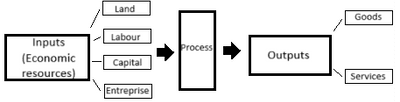
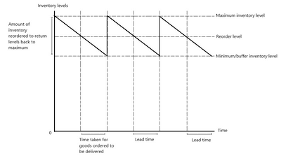

# Operations Management

## Production of Goods and Services

**Production Process**

 

* **Production**: making a product or service to satisfy consumer wants and needs.
* **The factors of production or ‘inputs’ include:**
  * **Land** – For factories or materials
  * **Labour** – Employees
  * **Capital** – Money/finance
  * **Enterprise** – Managers
* A business combines these inputs to produce a more valuable output (this is added value).
* **Labour-Intensive Production: A** larger workforce is used than machinery to make goods. Usually done in countries with low wages so that it is more efficient (ex: SHEIN).
* **Capital-Intensive Production**: businesses use machinery rather than workers. Usually done in developed countries where the wages are high.

### **Operations Department**

* The operations department’s role is to transform inputs into outputs for consumers.
* An **operations manager** ensures raw materials are available and made into finished goods.
* **Most manufacturing businesses have:**
  * **Factory Manager** - responsible for quality and quantity of products
  * **Purchasing Manager** – responsible for providing the required materials and equipment
  * **Research and Development Manager** – responsible for design and training of employees for new products
* In the retail business, the factory manager will be replaced by the managers for the shop.
* In service businesses, e.g. Restaurants, the operation department will include managers for each shop.

### **Productivity**

* **Productivity**: a way of measuring a business’s efficiency.
* **Note**: Production is the making of the product, while productivity is how efficiently the product is made.
* $\text{Productivity} = \frac{\text{Quantity of output}}{\text{Quantity of input}}$
* $\text{Labour Productivity} = \frac{\text{output}}{\text{no. of employees}}$
* As employees become productive, per-employee output rises, and costs of production fall
* **Many ways to increase productivity:**
  * Improve factory layout to reduce time waste and raise efficiency
  * Introduce automation
  * Improve labour skills by training
  * Improve quality control
  * Improve employee motivation
  * Improve inventory control
* **Benefits of increasing efficiency:**
  * More output compared to inputs.
  * Lower costs per unit (and therefore lower average cost)
  * For example, if the business has a limited workforce, raising their wages will increase motivation and, therefore, also increase productivity.

### **Inventory**

* Inventory can take various forms. **Inventory includes:**
  * Raw materials
  * Work in progress goods
  * Finished goods
* **Why do businesses hold inventory?**
  * To ensure enough inventory is available to satisfy sudden changes in demand.
  * Production and opportunity costs will also be high if inventory levels are high.
* **Inventories can be managed:**

 

* The business buys in inventory to fill its holding capacity, known as the maximum inventory level.
* As resources are depleted, inventory levels drop. At this stage, reorders will be made so it reaches the business in time before it runs out.
* **Buffer Inventory Level**: inventory held to deal with uncertainty in customer demand and deliveries of supplies.

