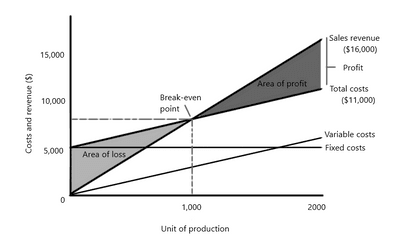

## Break-Even Analysis

* **Break-Even Level of Output:** the quantity that must be produced/sold for total revenue to equal total costs. (also known as break-even point).
* **Break-Even Charts:** a graph showing how the costs and revenues of a business change with sales. They show the level of sales the business must make to break even.
* **Revenue**: the income during a period of time from sales of goods.
  * Total Revenue = Quantity sold **×** Price.
* **Break-Even Poin**t: the level of sale at which total costs = total revenue. The point where they intersect in the graph.
* The break-even point, the **calculation method**:
  * Contribution: selling price less its variable cost.
  * Contribution per unit: Selling price **–** Variable cost.
  * $\text{Break-even level of production} = \frac{\text{Total fixed costs}}{\text{Contribution per unit}}$
* **An example of a Break-even chart:**

 

|    | Sales($)= 0 units | Sales($)= 1000 units | Sales($)= 2000 units |
|----|----|----|----|
| Fixed costs | 5000 | 5000 | 5000 |
| Variable | 0 | 3000 (1000x$3) | 6000 (2000x$3) |
| Total costs | 5000 | 8000 (3000+5000) | 11000 (5000+6000) |
| Revenue | 0 | 8000 (1000x8) | 16000 (2000x8) |

* **To draw a break-even chart, you must include:**
  * Fixed Costs line
  * Variable Costs line
  * Total Costs line
  * Sales Revenue line
* The shaded area that can be seen, labelled with ‘Area of loss‘, shows how the sales revenue line is below the Total cost line, indicating that anything before the break-even point is a loss.
* The shaded area that can be seen, labelled with ‘Area of profit’, shows how the sales revenue line exceeded the Total cost line, indicating anything after the break-even (BE) point is a profit.
* ‘y’ axis measures money amounts (cost & revenue)
* The ‘x’ axis shows the number of units produced or sold
* **Benefits of break-even charts:**
  * Managers can read off the graph if the company **expects profit or loss** and can see how much profit/loss they will have at any level of output
  * They can **attempt different scenarios** and see the impact it will have on the profit or loss of the business. It lets managers **try out different possibilities** to determine which is the best. (i.e. increasing the selling price, increasing production)
  * It can show the **SAFETY MARGIN** – the **number of sales exceeds the break-even point**. For example, if a business’ break-even point is at 1000 units, and they’re producing 1500 units, their safety margin is 1500 – 1000 = 500.
* **Limitations of Break-even Charts:**
  * Break-even charts **assume that all products made will be sold**. It does not show the possibility that inventories may build up if they are not sold
  * Fixed costs only stay the same **if the scale of production stays the same** (doubling the output will also increase the fixed cost because they must need a bigger factory, more machinery, labour, etc.)
  * Break-even charts **assume that costs and revenues can be drawn with straight lines**, which doesn’t happen in real life.
  * It assumes costs and revenue increase at a constant rate.

