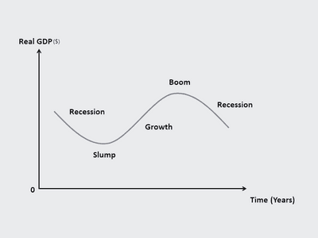

# External Influences on Business Activity

## Economic Issues

### **Main Stages of the Business Cycle and Trade Cycle**

* **Gross Domestic Product (GDP)**: the total value of the output of goods and services in a country in one year.

  

* **Recession**: too little spending, falling GDP, demand and prices, workers lose jobs.

* **Slump**: long-drawn-out recession. Unemployment is higher, and prices fall; many businesses fail to survive at this point.

* **Growth**: GDP is rising, unemployment is falling, and living standards are higher. (Firms are doing well at this point).

* **Boom**: too much spending, inflation, shortage of workers, and businesses are uncertain about the future.

### **Impact on Business from Changes in Economic Indicators**

* Changes in employment levels will affect the ability of the business to recruit new employees and also the income of customers.
* Rising inflation may increase business costs, leading to higher product prices. The effect of increasing inflation depends on the type of product sold.
* An increase in GDP means the economy is growing. Increase in sales, higher income, but recruitment of employees hard.

### **Government Economic Objectives**

### **Low inflation**

* **Low Inflation**: Low prices of goods & services so that people will buy more money in the economy.
  * **Inflation**: The increase in average prices of goods & services.
* **Rapid inflation may lead to:**
  * A fall in the value of money falls in real incomes.
  * Wage price spiral.
  * Fall in international competitiveness as prices will be high.
  * Businesses may not want to expand and create jobs.
  * Living standards will fall.
* Low inflation rates will act as an incentive for firms to produce and encourage them to expand.

### **Low Unemployment**

* **Low Unemployment**: A high % of people work so that they don’t rely on government funds.
  * When people want to and have the ability to work but can’t work, then they are said to be unemployed.
  * The country's output will be lower if unemployed people don’t produce goods and services.
  * It involves an opportunity cost as the government has to pay greater unemployment benefits, which could be used to improve education and increase living standards.

### High Unemployment

* **High Unemployment:** A low % of people work, meaning a large portion of the population relies heavily on government funds.

  * When a significant number of people who are willing and able to work cannot find jobs, a country experiences high unemployment.

  * The country's total output falls drastically because a large number of citizens are not actively producing goods or services.

  * The government must spend more on unemployment benefits, creating an opportunity cost as these funds could have been used for education or infrastructure.

  * Because consumers lose their incomes, overall spending drops, leading to lower sales and revenue for businesses selling non-essential goods.

  * With many people competing for jobs, businesses find it much easier to recruit staff and do not face pressure to offer high wages.

### **Economic Growth**

* **Economic Growth**: growth of a country's GDP (Gross Domestic Product) – more goods and services being produced and sold.
  * If an economy’s total output rises, it is said to be experiencing economic growth.
  * GDP is the total value of goods and services produced in an economy.
  * Economic growth may cause employment to rise, increasing living standards and reducing poverty.
  * **A fall in GDP can lead to:**
    * Unemployment
    * Fall in average living standards as poverty rises
    * Less investment

### **Balance of Payment**

* **Balance of Payment** (of Imports & Exports): the difference between a country's imports and exports balance out (BoP = Exports – Imports).
  * **Exports**: Goods and services **sold** from one country to another.
  * **Imports**: Goods and services **bought** by one country from another.
* Balance of payments is a record of one country’s financial transactions internationally.
* Governments will aim for an equal balance of payments: exports equal imports.
* Higher imports than exports lead to a budget deficit.
* Higher exports than imports lead to a budget surplus.
* **Problems of Budget Deficit:**
  * The government can run out of foreign currency reserves and will have to borrow.
  * The exchange rate depreciates – the price of our currency falls as compared to the other currency.
    * **Exchange Rate**: the price of a currency in terms of another.