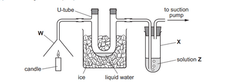
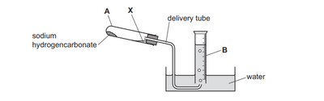
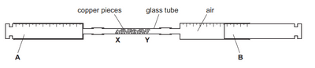
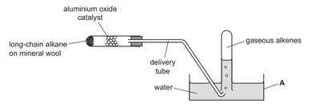

## Exemplar Past Paper Question

Here are samples of 2022 Questions about Labelling Apparatus

 1. Apparatus W is **Filter Funnel**

2. Apparatus X: **Boiling Tube/Test Tube**

    
3. Apparatus A: **Test Tube/Boiling Tube**
4. Apparatus B: **Measuring Cylinder**

    
5. Apparatus B is a **Gas Syringe**

    6.  Apparatus A is a **water bath/trough.**

