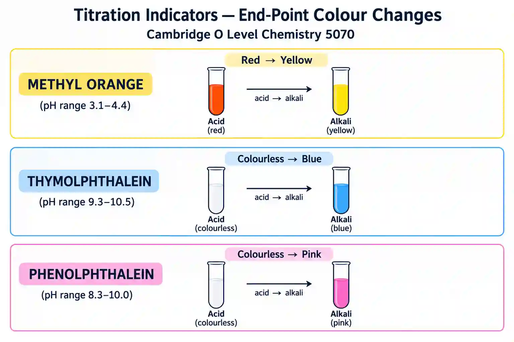

## Identifying the **end-point**

### End-Point

* The **end-point** is the point at which the indicator **changes colour** permanently, showing that neutralisation is complete.

### How to Identify the End-Point Accurately

#|
||

Technique

|

Why

||
||

Add acid **drop by drop** near end-point

|

Prevents in excess

||
||

**Swirl** flask continuously

|

Mixes solutions evenly

||
||

Use **white tile** underneath

|

Makes colour change easier to see

||
||

Wash sides of flask with **distilled water**

|

Ensures all reactants react

||
||

Stop when colour change **lasts 30 s**

|

Confirms permanent end-point

||
|#

