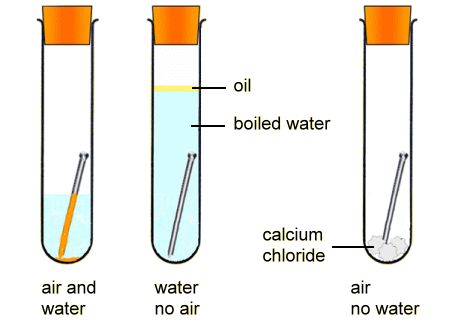
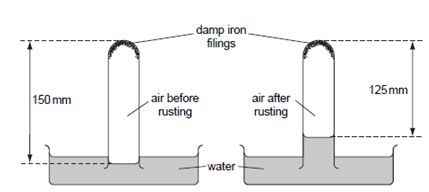

## Showing that Oxygen and Water are needed for Rusting Iron and that air is 21% Oxygen

* Shows that oxygen and water are needed for rusting iron

* Showing that air is 21% Oxygen

   

**Experiment: Showing air is \~21% oxygen**

* Air passed over heated copper turnings (or left with damp iron filings).

* Oxygen reacts with copper/iron → volume of air decreases.

* Measure initial and final volumes.

**Calculation example:**

% of oxygen = (25 ÷ 150) × 100 = 16.7% (oxygen content found)

**Note:**

* Expected value = \~21% oxygen.

* Measured value can be lower because **some oxygen dissolves in water**.