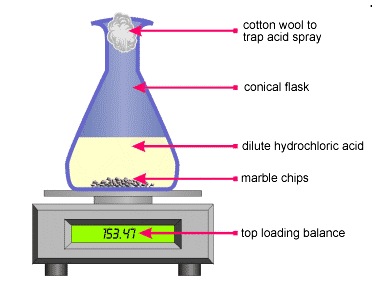
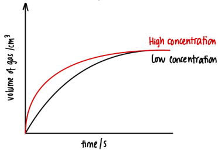
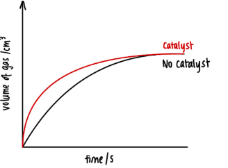
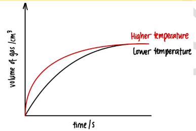
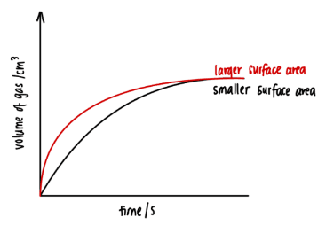

# Rates of Reaction

## Factors Affecting the Rate of Reaction

* Different temperature acid
* Different sizes of particle/reactants
* Concentration of acid

### Rate of Reaction Graphs

### Effect of Concentration on Rate of Reaction

Increasing the concentration of a reactant increases the rate of reaction because there are more frequent successful collisions between particles. If the concentration of the limiting reactant is increased, the total amount of product formed also increases.

1. Concentration

2. Catalyst

3. Temperature

4. Surface Area

