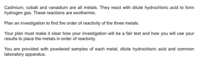

# Planning Investigation

## Ways to Tackle this Question

The Planning Investigation (6 marks) is one of the key highlights of the IGCSE Chemistry: Alternative to Practical, and it is possible to achieve full marks in this question. Unlike IGCSE Biology and physics, Chemistry requires a detailed step-by-step process in planning your investigation.

1. Independent Variable: The variable you will change
2. Dependent Variable: The variable you will measure.
3. Control Variable: Variables that you will keep the same.

**Key things which help to guide your response:**

* If there are large lumps, you must state, “Use a pestle and mortar to crush”. This will get you 2 marks.
* Stating the apparatus + exact volume/mass + name of chemical/substance, always!
  * E.g. Use a measuring cylinder to measure 50cm3 of hydrochloric acid
* Draw a labelled diagram (even if it doesn’t directly tell you to do this)
  * You may also get some marks on labels
* State the type of experiment you will carry out (e.g. chromatography/crystallisation)

**Example Question:**      **Complete six marks response:**

Prepare all the apparatus needed for this investigation. Weigh the same mass of the Cadmium metal and placed it in a beaker. Add 30cm^3 of dilute hydrochloric acid into the beaker, whose concentration remains unchanged. Observe the reaction in a set time of 2 minutes and record the gas produced using a gas syringe. Repeat the investigation using Cobalt and Vanadium. A conclusion can be made by comparing which metal produces the largest gas volume and placing it accordingly from least to most reactive.