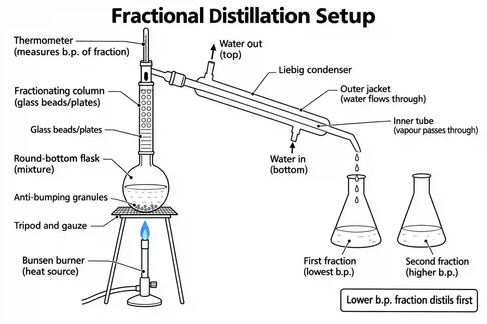

## Fractional Distillation

### What It Does

**Fractional distillation** separates **two or more miscible liquids** with **different boiling points**.

### Apparatus required for simple distillation

#|
||

Apparatus

|

Use

||
||

Round-bottom flask

|

Holds mixture

||
||

Fractionating column

|

Separates vapours by b.p.

||
||

Thermometer

|

Measures vapour temperature

||
||

Liebig condenser

|

Cools vapour to liquid

||
||

Conical flask

|

Collects distillate

||
||

Heat source

|

Heats mixture

||
|#

### Method

#|
||

Step

|

Action

||
||

1

|

Place mixture in round-bottom flask

||
||

2

|

Heat gently

||
||

3

|

Liquid with **lower b.p.** evaporates first

||
||

4

|

Vapour rises up fractionating column

||
||

5

|

Vapour condenses and re-evaporates multiple times

||
||

6

|

**Lowest b.p. fraction** distils first

||
||

7

|

Collect fractions at different temperatures

||
|#

### Key Points

#|
||

Point

|

Why

||
||

**Fractionating column**

|

Provides surface for repeated condensation/evaporation

||
||

**Collect fractions at different temps**

|

Each fraction has different b.p.

||
||

**Lower b.p. = distils first**

|

More volatile

||
|#

### Example

**Mixture:** Ethanol \+ Water

* **Ethanol (b.p. 78°C)** distils first

* **Water (b.p. 100°C)** distils later