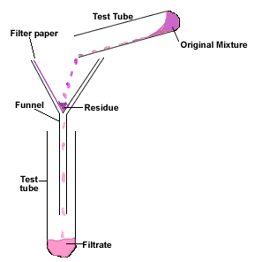
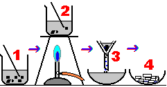

# Separation Techniques

## Filtration and Crystallisation

* **Filtration**
  * The mixture goes in a funnel with filter paper into a flask.
  * Residue is insoluble, and filtrate goes through

* **Crystallization**
  * Some water in the solution is evaporated, so the solution becomes more concentrated.
  * The solution is left to cool and crystallise (**solubility decreases as temperature decreases**)
  * Crystals are filtered to remove solvent.

  **Cooling effect:**
  * Quick cooling → smaller crystals

  * Slow cooling → larger crystals

**Common Question: How can we obtain pure dry crystals from the filtrate?**

1. Pour the filtrate into the evaporating basin and heat
2. Leave to evaporate and let it cool to the crystallisation point
3. Wash the crystals with distilled water
4. Dry it between the filter paper.