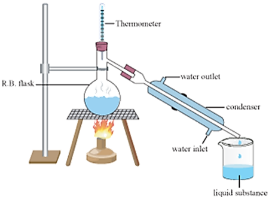

## Simple Distillation

* The impure liquid is heated
* It boils, and steam rises into the condenser
* Impurities are left behind
* The condenser is cold so the steam condenses to pure liquid, and it drops into the beaker

