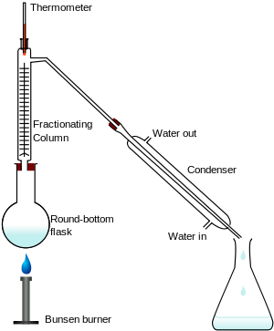

## Fractional Distillation

* Removes a liquid from a mixture of liquids because liquids have different b.p.s
* The mixture is heated to evaporate the substance with the lowest b.p.
* Some of the other liquid(s) will evaporate too.
* Beads are heated to the boiling point of the lowest substance so that a substance being removed cannot condense on beads.
* Other substances continue to condense and will drip back into
  the flask
* The beaker can be changed after every fraction.
* The thermometer is placed on the top to **measure the temperature of the vapour instead of the liquid**

* When distilling flammable liquids (e.g. ethanol), use a water bath or heating mantle instead of a Bunsen burner.