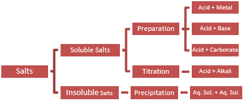

# Making Salts

## Metal and an Insoluble Base

 

### **Starting with a metal:**

1. Warm acid (increases speed of reaction)
2. Add an excess of reactant + stir
3. Filter mixture
4. Transfer to evaporating basin
5. Heat using a Bunsen burner
6. Leave to cool until crystallisation point
7. Wash crystals with distilled water
8. Dry crystals on filter paper

### **Starting with an insoluble base:**

* Add insoluble base to acid and heat gently; it will dissolve
* Keep adding until no more dissolves (reaction is done)
* Filter out the insoluble (excess) base

