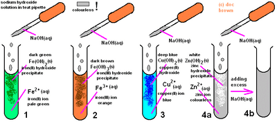

## Precipitation

* Mix the two soluble salts so they react together
* Filter the mixture to separate the products produced (soluble
  and insoluble salt produced)
* Wash the insoluble salt on the filter paper
* Dry the insoluble salt between the filter paper  

