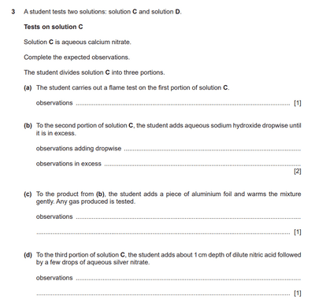

# Harder Ion Testing Question

In this question, even though the Cation and Anion Tests are given at the back of the paper. Some questions maybe unfamiliar to you. If you have cross checked multiple times, and still it doesn’t show, it might be a “no reaction” answer.

 

1. If nothing happens (i.e. there is no reaction), put “No Change”
2. If it says “condensation forms on the side of the test tube”, it is hydrated
3. If a solid is coloured, it is a transition metal
4. If it is non-transition metal, it is a white solid OR colourless solution
5. When the liquid was touched with a lighted splint, it burns with a blue flame, it is an organic fuel (flammable)

