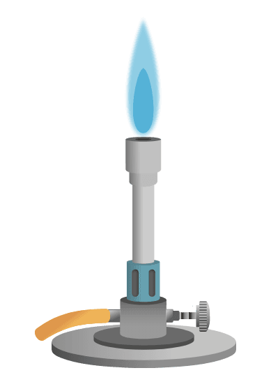

## Process of Flame Testing   

* Dip an **unreactive (platinum or nichrome)** wire into concentrated hydrochloric acid, and then hold it in the blue flame of a Bunsen burner until there is no colour change.
* Dip the loop into the solid sample and place it on the edge of the **blue** Bunsen flame.
* Observe the flame colour and record it down.

1. **How is the Bunsen burner adjusted to give a scorching flame?**

By opening the air hole to increase air supply.