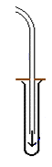
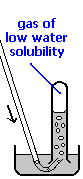
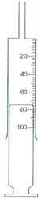

# Collecting Gases

## Method of Gas Delivery

| Method | Downward Delivery | Upward Delivery | Collection Overwater | Gas syringe |
|----|----|----|----|----|
| Use when... | Gas more dense than air | Gas is less dense than air | Gas is sparingly soluble in water | To measure the volume |
| Apparatus |   |   |   |   |
| Examples | Carbon dioxide, chlorine, sulfur dioxide, hydrogen chloride | Ammonia, hydrogen | Carbon dioxide, hydrogen, oxygen | Any gas |

