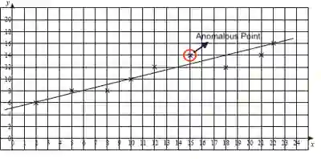

# Drawing Graphs

## Rules and Requirements of Drawing Graphs

Drawing Graphs in IGCSE Sciences is such an essential skill that it is worth full of free marks in these questions. Here are the rules and requirements to earn the full mark.

1. Use a sharp pencil

2. Label both axes with units (IV on the x-axis, DV on the y-axis)

3. Labels should be in the form “quantity/units.”

4. Choose appropriate scale

5. Use crosses “x” to mark the data points (for scatter graphs)

6. The graph should cover at least half the grid

7. Include an appropriate title

8. Include a line of best-fit

9. Circle anomalous results

   

**Common Question: Why does the graph level off?**

The reaction is finished, and ALL of the [named reactant] has reacted

**Common Question: Why must the graph line pass through (0,0)?**

It is because when no [named reactant] is added, there is no reaction