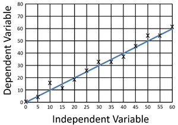

## Graphs

• Unless instructed otherwise, the independent variable **should be plotted on the x-axis** (horizontal axis) and the dependent variable **plotted on the y-axis** (vertical axis).

• Each axis should be labelled with the physical quantity and the appropriate unit, e.g. time / s.

• Unless otherwise instructed, the scales for the axes should allow more than half of the graph grid to be used in both directions and be based on sensible ratios, e.g. 2 cm on the graph grid representing 1, 2 or 5 units of the variable.

• The graph is the diagrammatic presentation, including the best-fit line when appropriate. It may have one or more sets of data plotted on it.

• Points on the graph should be marked as **crosses (×)** or **encircled dots (⊙)**.

• Large ‘dots’ are **penalised**. Each data point should be plotted to an **accuracy of over one-half** of each of the smallest squares on the grid.

• A best-fit line (trend line) should be a **single, thin, smooth straight line or curve**. The line does not need to coincide exactly with any of the points; where there is scatter evident in the data, Examiners would expect a roughly even distribution of points on either side of the line over its entire length. Anomalous points should be ignored when drawing the best-fit line.  