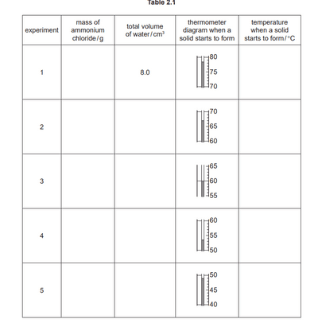

## Numerical Results

• Data should be recorded so as to reflect the precision of the measuring instrument.

• The number of significant figures given for calculated quantities should be appropriate to the least number of significant figures in the raw data used. 