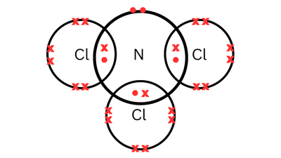
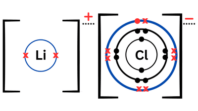

## Question 4

**4(a)** Pale yellow gas

**(b)**

- $\text{S}\\_x \text{F}\\_y ;  25.2% \times 254 = 64\text{(S)}$

- $\frac{64}{32} = 2 \to x = 2$

- $254 - 64 = 190\text{(F)}$

- $\frac{190}{19} = 10 \to y = 10$

- $\text{S}\\_{2} \text{F}\\_{10}$

**(c)**

**(d)**

**(e)** LiCl is an ionically bonded compound whereas, NCl$\\_3$ has covalent bonds $\therefore$ the attractive forces between the molecules in NCl$\\_3$ are weaker than the attractive forces between molecules of LiCl