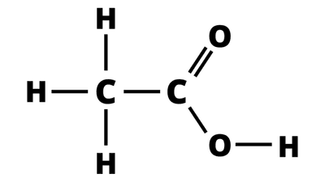

## Question 5

**5(a)** Fermentation

**(b)**

* **Name:** Complete Combustion

* **Equation:**  $C_{2}H_{5}OH + 3O_{2} \to 3H_{2}O + 2CO_{2}$

**(c)(I)** Ethene

**(II)** Addition reaction

**(III)** Steam, Catalyst at 300 $^\circ$C and 60 atm

**(d)(I)** Hydrogen gas, High temperature and Nickel catalyst.

**(II)** $C_{n}H_{2n+2}$

**(e)(I)** Potassium manganate(VII)

**(II)** Carboxylic acids

**(III)**

