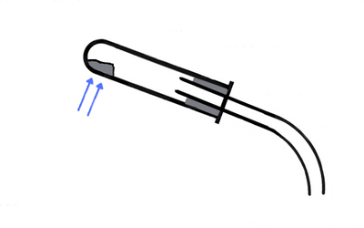

# 0620/62/M/J/22

## Question 1

**1(a)**

* **A**: Boiling tube

* **B**: Measuring cylinder

**(b)** Water

**(c)**

**(d)** The volume of gas stops changing

**(e)** The boiling tube will start cracking as soon as the heating is stopped, water may also start going back into the tube due to no gas pressure