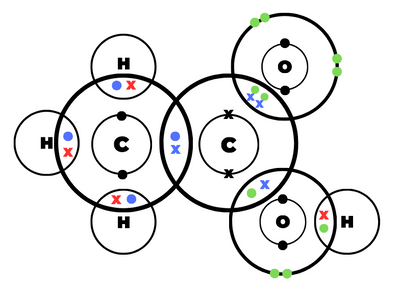

## Question 4

**4(a)** Proton acceptor

**(b)** Alkali

**(c)** Blue

**(d)**

**sodium hydroxide** + **ammonium chloride** $\to$ sodium chloride + water + ammonia

**(e)(i)** Amphoteric oxides

**(ii)** Aluminium/zinc oxide

**(f)(i)**

**(ii)** 3 $\le$ pH $\le$ 7

**(iii)**

CH$_{3}$COOH $\rightleftharpoons$ CH$_3$COO$^–$ + H$^{+} $

**(iv)**

H$^+$ + OH$^–$ $\to$ H$_2$O

**(v)**

Number of moles of  KOH:

- KOH: 25cm$^3$, 0.08mol.dm$^{-3}$

- 25cm$^3$ = $\frac{25}{1000}$ dm$^3$ = 0.025 dm$^3$

- mol = concentration $\times$ volume = 0.08mol.dm$^{-3}$ $\times$ 0.025dm$^3$

- mol = 0.002mol

Number of moles of H$_{2}$SO$_4$ that react with KOH:

- 2KOH $:$ H$_2$SO$_4$

- 0.002 $:$ 0.001

- = 0.001mol

Concentration of H$_2$SO$_4$ in $\frac{\text{mol}}{\text{dm}^3}$:

- H$_2$SO$_4$: 20cm$^3$, 0.001mol

- conc = $\frac{\text{mol}}{\text{volume}}  = \frac{0.001}{0.02} = 0.05$

- = 0.05 $\frac{\text{mol}}{\text{dm}^3}$

Concentration of H$_2$SO$_4$ in $\frac{\text{g}}{\text{dm}^3}$

- $0.05 \frac{\text{mol}}{\text{dm}^3} \times 97 \frac{g}{dm^3} = 4.85 \frac{g}{dm^3} = 4.9$