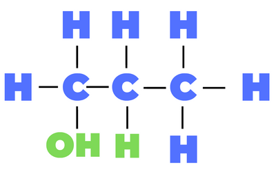
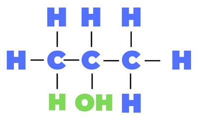

## Question 5

**5(a)(i)** Substitution

**(ii)** It provides activation energy

**(iii)** Photochemical

**(iv)** C$\\_3$H$\\_8$ +Cl$\\_2$ $\to$ C$\\_3$H$\\_7$Cl + HCl

**(b)(i)** It has carbon-carbon double bonds

**(ii)** CH$\\_3$CHClCH$\\_2$Cl

**(c)**
Product A:

propan-1-ol

Product B:

propan-2-ol

