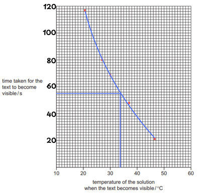

## Question 2

**2(a)**

|**experiment**|**time taken for the text to become visible /s**|**temperature of the solution when the text becomes visible / $^{\circ}$C**|
|:---|:---|:---|
|1|116|20.5|
|2|80|27.0|
|3|69|30.0|
|4|46|37.0|
|5|21|46.5|

**(b)**

**(c)** Experiment 5

**(d)** 34

**(e)** Wrapping the beaker creates insulation which reduces the heat loss so temperature is more constant

**(f)(i)** burette is more accurate than a measuring cylinder

**(ii)** pipettes are slow in adding sodium thiosulfate, so the reaction will start before it gets completely added

**(g)** Reaction will start at a lower temperature

**(h)**

- Time will decrease
- Height of the solution would decrease i.e. less depth to look through