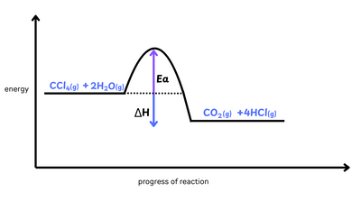

## Question 5

**5(a)** Enthalpy change of reaction

**(b)(i)** Rate of reaction increases because increasing the concentration of CCl$\\_4$ results in more particles per unit volume, so more frequent collisions occur.

**(ii)** Position of equilibrium shifts to left side because left side has fewer number of gas(eous) moles.

**(iii)**

**(iv)** Minimum energy needed for the colliding particles to react.

**(v)** activation energy decreases by adding catalyst.

**(c)**

- Energy needed to break bonds: 4 $\times$ 340 + 4 $\times$ 460 = 3200kJ

- Energy needed to released when bonds are made: 2 $\times$ 805 = 1610kJ

- H-Cl bond energy: 3200 - (1610+4(H-Cl) = -130

- 4(H-Cl) = 3330-1610 = 1720

- H-Cl = $\frac{1720}{4}$ = 430kJ.mol$^{-1}$