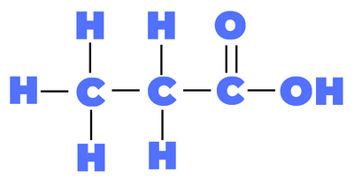

## Question 6

**6(a)**

- Same general formula
- Contain the same functional group

**(b)** CH$\\_2$ unit

**(c)(i)**

- **A:** Alkenes
- **B:** Alkanes
- **C:** Carboxylic acids

**(ii)**

**Name:** Propanoic acid

**(d)(i)**
use the molecular masses of the elements and multiply them by the number of each element

- 4(H) + 2(C) + 1(N) + 2(O)

- 4(1)+ 2(12) + 1(14) + 2(16) = 74

- 103-74 = 29

- R = C$\\_2$H$\\_5$

**(ii)** Proteins