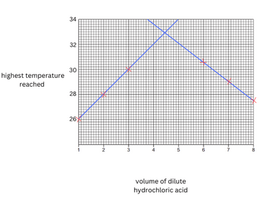

## Question 2

**2(a)**

|**experiment**|**volume of dilute hydrochloric acid / cm$^3$**|**volume of aqueous sodium hydroxide / cm$^3$**|**highest temperature reached / $^\circ$C**|**pH**|
|:---|:---|:---|:---|:---|
|**1**|**1.0**|9.0|26.0|**11**|
|**2**|**2.0**|8.0|28.0|**11**|
|**3**|**3.0**|7.0|30.0|**11**|
|**4**|**6.0**|4.0|30.5|**1**|
|**5**|**7.0**|3.0|29.5|**1**|
|**6**|**8.0**|2.0|27.5|**1**|

**(b)**

**(c)(i)**

- **Vol of dilute hydrochloric acid:** 4.45 cm$^3$
- **Vol of aqueous sodium hydroxide:** 5.55 cm$^3$

**(ii)**

- pH: 7

**(iii)**

- **Most concentrated solution:** Hydrochloric acid
- The volume needed to become neutral was lower than the volume of NaOH

**(d)**

- No change
- Higher 
- It is a better insulator compared to a boiling tube, because of this it prevents heat loss to the surroundings.

**(e)** Pipette do not measure variable volumes