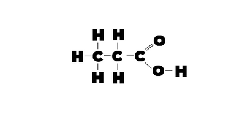
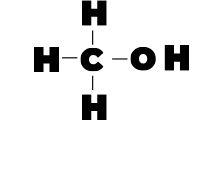

## Question 4

**4(a)** C$*{2}$H$*$O

**(b)**  Methyl Propanoate

**(c)** Propanoic Acid

**(d)** Methanol

**(e)**

|**change of condition**|**effect on the concentration of carboxylic acid X at equilibrium**|
|:---|:---|
|**temperature is decreased**|decreases|
|**concentration of CH$_3$CH$_2$COOCH$_3$**|decreases|
|**more alcohol Y** is added|decreases|
|**a catalyst is added**|no effect|

**(f)(i)**

* **pH at start of reaction:** 7

* **pH at equilibrium:** 3 $\ge$ pH < 7

**(ii)** H$^+$(aq)

**(iii)** Universal indicator