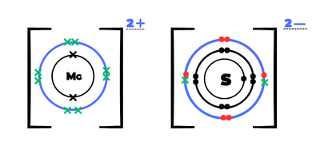

## Question 5

**5(a)(i)**

||**$^{32}$S**|**$^{34}$S**|
|:---|:---|:---|
|**protons**|16|16|
|**neutrons**|16|18|

**(ii)** Same electronic structure

**(iii)** 34g

**(iv)** 1 mole

**(v)**

* (32 $\times$ 95) + (34 $\times$ 5) = 3210

* $\frac{3210}{100}$ = 32.1

**(b)(i)**

**(ii)** It has strong ionic bonds

**(iii)** mobile ions

**(c)(i)**  H$_{2}$SO$_{3}$

**(ii)** SO$^{2-}_{3}$

**(d)(i)** Oxidation number of manganese is +7

**(ii)** purple to colorless