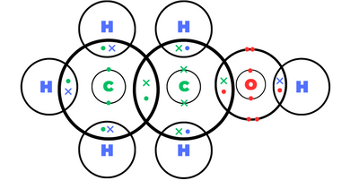

## Question 6

**6(a)(i)** photosynthesis

**(ii)** 6CO$_{2}$ + 6H$_{2}$O $\to$ C$_{6}$H$_{12}$O$_{6}$+ 6O$_{2}$

**(iii)** Energy from light and presence of chlorophyll

**(b)(i)** Fermentation

**(ii)** Carbon dioxide

**(c)(i)**

* 300$^\circ$C

* 60 atm

* Acid

**(ii)** Only one product is formed

**(iii)**

