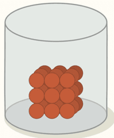
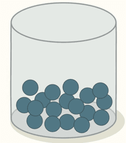
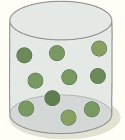

# States of Matter

## Solids, Liquids and Gases

* States of Matter are the different forms in which matter can exist
* The three states of matter are **Solid, Liquids, and Gases**

### **Properties of Solid, Liquid and Gases**

#|
||

⠀

|

Solids

|

Liquids

|

Gases

||
||

Shape

|

have a definite shape

|

take the shape of their container

|

take the shape of their container

||
||

Density

|

high

|

medium

|

low

||
||

Volume

|

have a fixed volume

|

have a fixed volume

|

no fixed volume

||
||

Particle Motion

|

particles can vibrate about their fixed positions

|

particles can move past one another

|

particles are mobile and move randomly

||
||

Particle Arrangement

|

particles are arranged regularly in a lattice

|

particles are randomly arranged

|

particles are randomly arranged

||
||

Diagram

|

|

|

||
|#

