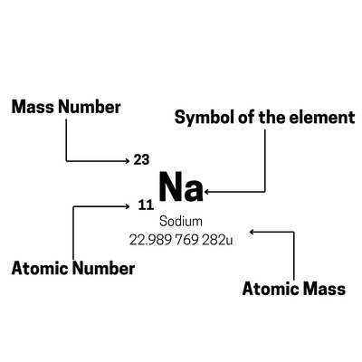

## Proton and Nucleon Number

* The **Proton Number (Atomic Number)** is **the number of protons in the nucleus of an atom**.
* It is unique to each element. It is denoted by the letter “Z”. For a neutral atom, the number of protons and electrons are equal; therefore, the proton number (Z) also corresponds to the number of electrons.
* The **Nucleon Number (Mass Number)** is **the total number of protons and neutrons** in the nucleus of an atom.
* **Mass number = number of protons + number of neutrons**

  **Number of protons = mass number – number of neutrons**

  **Number of neutrons = mass number – number of protons**
* The following format (AZX Notation) is shown below:
