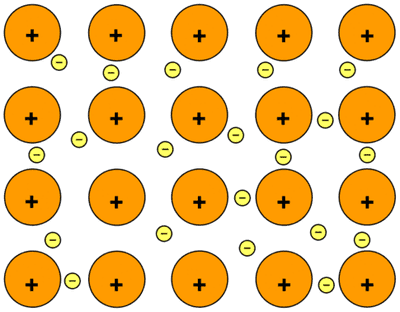

## Metallic Bonding

**Metallic Bonding:** the electrostatic attraction between the positive ions in a giant metallic lattice and a “sea” of delocalised electrons.   

* M⁺ = metal cations

* e⁻ = delocalised electrons

### **Properties of Metallic Bonding**

1. Metallic Bonds have good electrical conductivity: **Delocalised electrons can move through the structures and carry current.**
2. High Melting and Boiling Point: **More energy to overcome strong forces of attraction between positive metal ions and the sea of delocalised electrons and vibrate/transfer heat**
3. Malleability: Can be **hammered into shapes** as **layers can slide over each other.**
4. Ductility: Can be **drawn into thin wires**